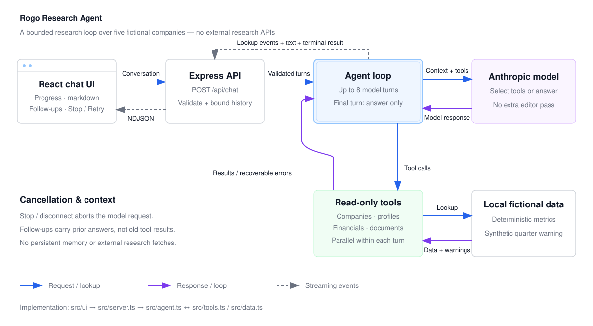

# Rogo Research Agent — engineering exercise

This is a small, working research agent. An analyst asks a question about a company;
the agent calls a few research tools and answers.

## What changed

This version prioritizes trustworthy financial answers and a visible research process:

- Growth rates and margins are computed in code; the extra editor model call is removed.
- Independent lookups run in parallel, errors are recoverable, and research has a final-answer step budget.
- The UI streams research progress and answers, supports follow-ups, renders markdown tables, and offers Stop/Retry/New chat.
- Preliminary periods, ambiguous company names and synthetic quarterly figures have explicit handling.

Start with [NOTES.md](NOTES.md) for the rationale and verification. Coding agents
should also read [AGENTS.md](AGENTS.md).

The original exercise asks for a focused improvement within 60–90 minutes,
prioritizing the quality of decisions over the amount of code.

## Architecture



[PNG version](docs/architecture.png). Independent tools run in parallel within a
model turn; results return to the next model turn. Progress and answer text stream
back through the API.

## Setup

Requires Node 22.12+ on the Node 22 line, or Node 24 (including the test runner).

```bash
npm ci
cp .env.example .env
# Edit .env and set ANTHROPIC_API_KEY to your own Anthropic key.
npm run dev
```

Open http://localhost:5173. The agent server logs its tool calls to the terminal,
including latency, model iterations, tool calls and token usage. Keep `.env` local;
it is ignored by Git. The app and live eval make real model API calls.

Optional `.env` settings: `ROGO_MODEL` selects the model (default: `claude-sonnet-5`);
`PORT` changes the API port (default: `8787`). If you change `PORT`, also update
the proxy target in `vite.config.ts`.

## Try it

Some questions to start with:

- "Compare Acme and Globex and tell me which one appears to be growing faster."
- "What are the biggest risks Umbrella Health flags in its filings?"
- "How is Initech's subscription transition going?"
- "Which company in the universe is growing fastest?"
- "Is GLBX a better business than ITCH?"
- "Did Globex revenue accelerate from Q2 to Q3 FY2025?" (should explain the synthetic-data limitation)

## The code

Main entry points:

| File | What it is |
| --- | --- |
| `src/server.ts` | Express server, one `POST /api/chat` endpoint |
| `src/agent.ts` | The agent loop — system prompt, tool-use loop, final answer |
| `src/tools.ts` | Tool schemas and tool execution |
| `src/data.ts` | All the research data. Fictional, local, deterministic |
| `src/validate.ts` | Validates and bounds conversation history |
| `src/ui/App.tsx`, `src/ui/api.ts` | Chat interface and streaming client |
| `src/*.test.ts`, `scripts/eval.ts` | Offline tests and live model checks |
| `src/ui/main.tsx`, `src/ui/styles.css` | Mount point and styling |
| `vite.config.ts`, `package.json` | Vite dev server proxies `/api` to port 8787 |

There are five fictional companies. The tools are backed entirely by `src/data.ts` —
no external research network calls. Only the model needs an API key. Each tool
sleeps for a few hundred milliseconds to stand in for a real API.

### Scripts

| Command | What it does |
| --- | --- |
| `npm run dev` | Runs the agent server and the web UI together |
| `npm run dev:server` | Agent server only, on port 8787 |
| `npm run dev:web` | Web UI only, on port 5173 |
| `npm run typecheck` | `tsc --noEmit` |
| `npm test` | Runs Vitest |
| `npm run eval` | Runs eight live-model cases with heuristic fact/caveat checks (uses API credits) |

The model defaults to `claude-sonnet-5`. Set `ROGO_MODEL` in `.env` to change it.

## Validation and limits

```sh
npm test
npm run typecheck
# Requires the model key and incurs API usage:
npm run eval
```

Offline tests and type checking do not need a key. The live eval checks selected
strings, not every claim or source, and model output varies between runs.

All companies and data are fictional. Quarterly figures are allocated from annual
figures using fixed weights, not reported quarterly results. They cannot support
real quarterly momentum conclusions. Citations are model-generated references,
not mechanically verified. Follow-ups retain previous answers but not tool results.
There is no authentication, persistence or rate limiting; run this as a local demo.

## Submitting

Commit your work on a branch and send us the repo (or a zip, or a PR — whatever is
easiest). If you want to leave notes on what you changed and why, add a short
`NOTES.md`. Bullet points are fine; please don't write a design document.

If you noticed something you deliberately chose *not* to fix, that is worth a line
too — we will ask about it either way.
